# Slop Factory

A desktop app for running coding agents on your projects. Open a few projects side by side, see
each one's delivery plan as a live board, hand the agent a task, a bug, a whole phase or several
streams of work at once, review what it changed, and answer its questions without digging through
the conversation.

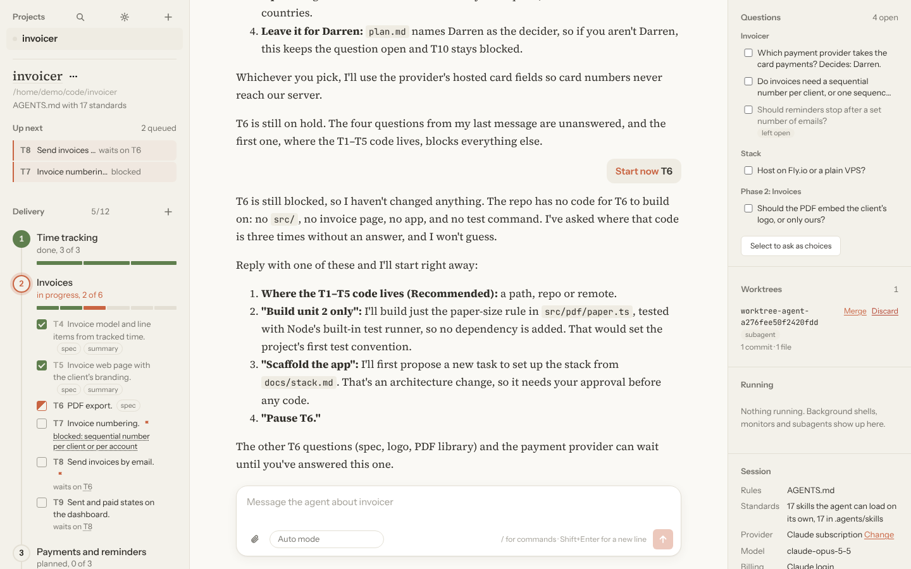

Slop Factory runs Claude Code underneath, with your Claude subscription or a local model, so a
project's `AGENTS.md`, skills, settings and hooks work as they do in the terminal. It's built around
[agent-framework](https://github.com/bizzehdee/agent-framework)'s planning and task-tracking
standards, and works with any project.

## Install

Download the latest installer from the [Releases page](https://github.com/bizzehdee/slop-factory/releases):

| System | Download |
|---|---|
| Windows (64-bit) | `Slop Factory_x.y.z_x64-setup.exe` or the `.msi` |
| macOS (Apple silicon and Intel) | `Slop Factory_x.y.z_universal.dmg` |
| Linux (64-bit) | `.deb` (Ubuntu, Debian), `.rpm` (Fedora, openSUSE) or `.AppImage` (anything else) |

You also need **a Claude subscription**, or a local model server (see [Local models](#local-models)).
Everything else comes in the installer, apart from [git](https://git-scm.com/downloads), which the
[git features](#git) use if you have it.

The installers aren't signed yet. On macOS, open the app the first time with right-click, then
**Open**. On Windows, choose **More info**, then **Run anyway**.

## Getting started

1. **Sign in.** If Claude Code is already signed in on this computer, Slop Factory uses that login.
   Otherwise it asks you to **Sign in with Claude** when it starts: finish in your browser, and paste
   the code the page shows if it asks for one.
2. **Create or open a project** with the **+** beside Projects. Opening a folder works for any
   project; creating one sets it up for you (see [New projects](#new-projects)).
3. **Ask for something** in the message box, or use the ⋯ menu on a task.

Open as many projects as you like. Each has its own agent, and work carries on in the ones you
aren't looking at. Switch with the sidebar or Ctrl/Cmd+1–9; the sidebar shows which projects are
working and which need you, and a desktop notification tells you when one you aren't looking at
finishes or is waiting for an answer.

Conversations carry on where they left off when you reopen the app. Choose **New conversation** in
the project menu to start afresh.

## The delivery board

The left side shows the project's plan, read from its files and updated the moment they change,
whoever changed them:

- **Phases** from `task.md`, each with its tasks from `tasks/task_phase_<n>.md` and a progress bar.
  The current phase opens by itself. Tick a task's box to mark it done.
- **Bugs** from `tasks/bugs.md`.
- **Specs and summaries.** A task's `spec` and `summary` chips open them, formatted, beside the
  conversation.

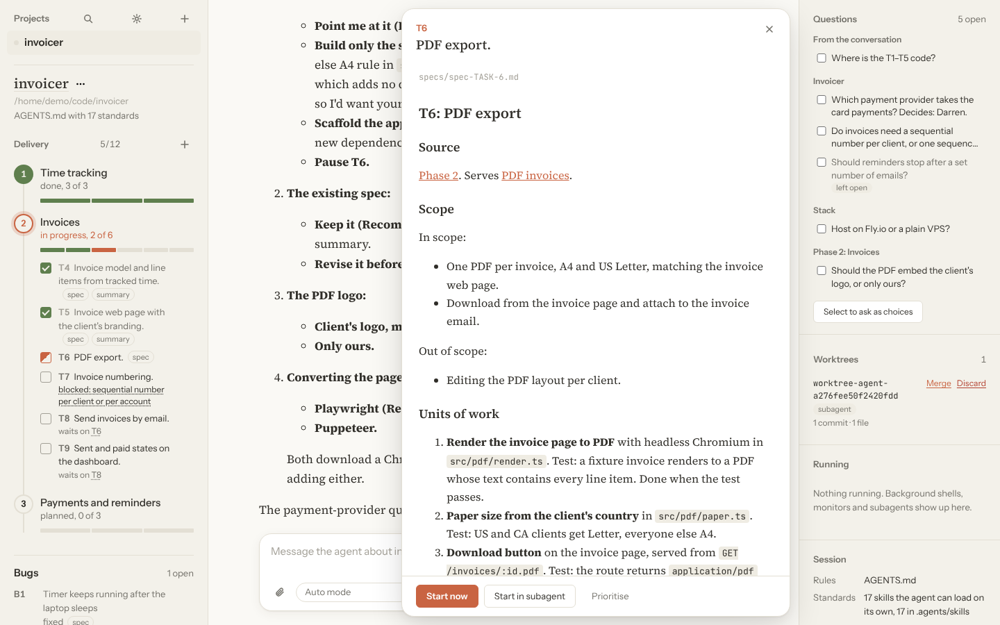

- **What's blocking what.** An open task shows **waits on T4** while a task it depends on is
  unfinished, and each **Blocked by** reason. Click one to go to the blocker: another task or bug on
  the board, the open question it's waiting on, or the place the reason is written.
- **Project summary.** Click the project's name to read its `plan.md`.
- **Add things as they come up.** The **+** beside Delivery adds a task to a phase, reports a bug, or
  records an open question, straight into the project's files with the next free number.

Projects that keep one older-style `TASK.md` (sections of `TASK-001` entries with Deliverable,
Scope and Acceptance criteria) work too: each section becomes a phase, and a task's details open
from its entry.

## Handing out work

Every task, bug and phase has a ⋯ menu:

- **Start now** sends the work to the project's agent straight away.
- **Start in subagent** runs it in the background in its own git worktree, so it works in parallel
  with whatever else is going on and you can review and merge its branch afterwards.
- **Prioritise** queues it under **Up next**. Queued work starts by itself, in order, each time the
  agent finishes what it's doing. If the agent is free, it starts at once.
- **Show progress** opens its spec and summary; **Summarise work done** and **Reinvestigate** are
  there for finished work.

Starting a **phase** works through its open tasks: the first starts and the rest queue behind it.
Phases started in a subagent queue their tasks so each starts when the previous subagent finishes.
The queue respects dependencies: a task that waits on another starts once that one is done, and
whatever can go first goes first. Drag items in **Up next** into a new order (or use Alt+Up and
Alt+Down), and take anything off with its **×** whenever you like. Pressing Stop pauses the queue
until you start something again or choose **Start next**.

### Subagents and their worktrees

Work started in a subagent shows under **Processes** while it runs. **View** follows it live: what
it says, the commands it runs and what they return.

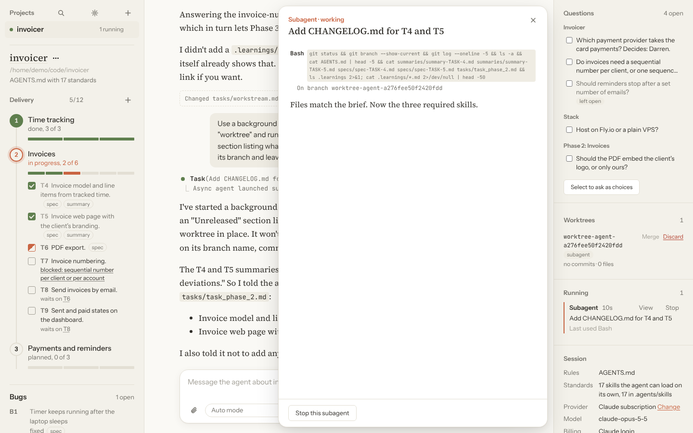

When it finishes, its branch appears under **Worktrees**. Open one to see its commits and the full
diff, then **Merge** it into your branch, **Ask the agent to merge** (it commits loose ends, resolves
conflicts and runs the tests), or **Discard** it.

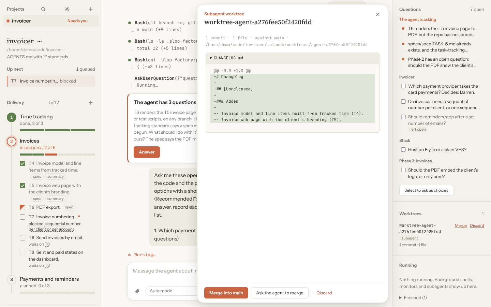

## Several agents at once: workstreams

When a project has work that doesn't overlap, separate agents can each take a stream of it at the
same time. Streams are listed in `tasks/workstream.md`:

- **No workstream file yet?** Choose **Find workstreams** on the board. The agent reads the tasks,
  their specs and the code, groups the work that can run side by side without touching the same
  files, and writes `tasks/workstream.md`. It doesn't start anything.
- **Have one?** The board shows each stream's progress and whether it's ready, waiting on another
  stream, running or done. **Run in parallel** lets you pick streams, and each starts in its own
  subagent and worktree, working through its tasks in order. Review and merge each branch under
  **Worktrees** when it's done.

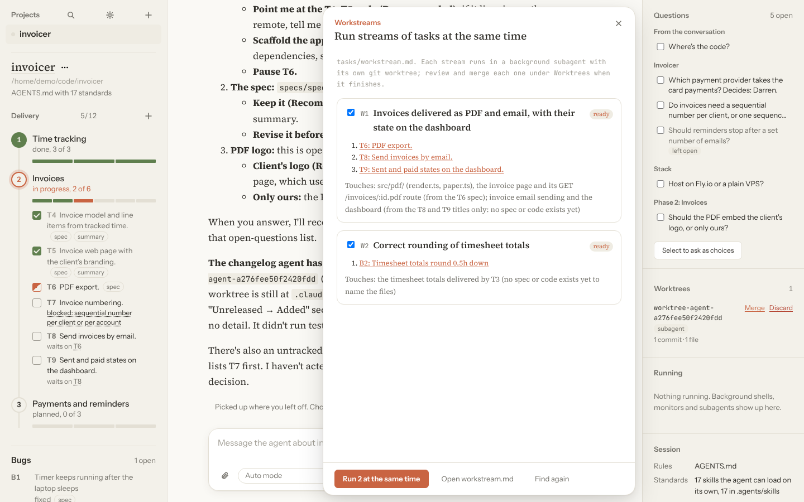

You can write or edit `tasks/workstream.md` yourself; [Project settings](docs/configuration.md#workstreams-file-format)
describes the format.

## The conversation

- **Attach files.** Drop or paste images, PDFs and text files onto the message box, or use the
  paperclip. The agent sees images and PDFs as they are.
- **Commands and skills.** Type `/` for the project's commands and skills, with what each does.

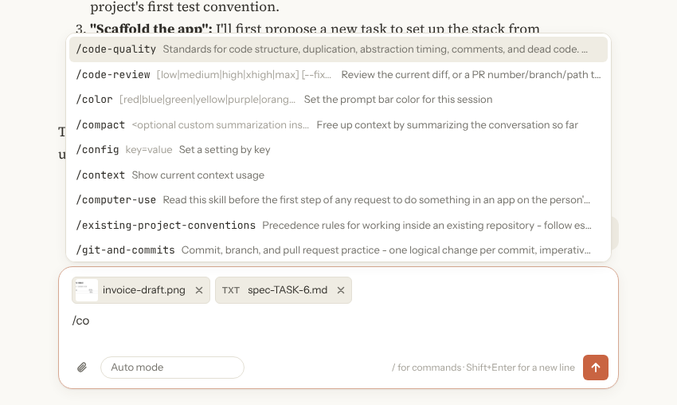

- **What each turn changed.** When the agent edits files, the turn ends with the files it changed.
  **Review** shows the edits; **Undo** puts those files back as they were before the turn.

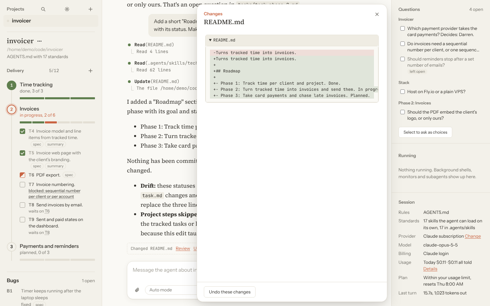

- **Search everything.** Ctrl/Cmd+K finds projects, tasks, bugs, phases, open questions, documents
  and messages across every open project, and goes to the one you pick.

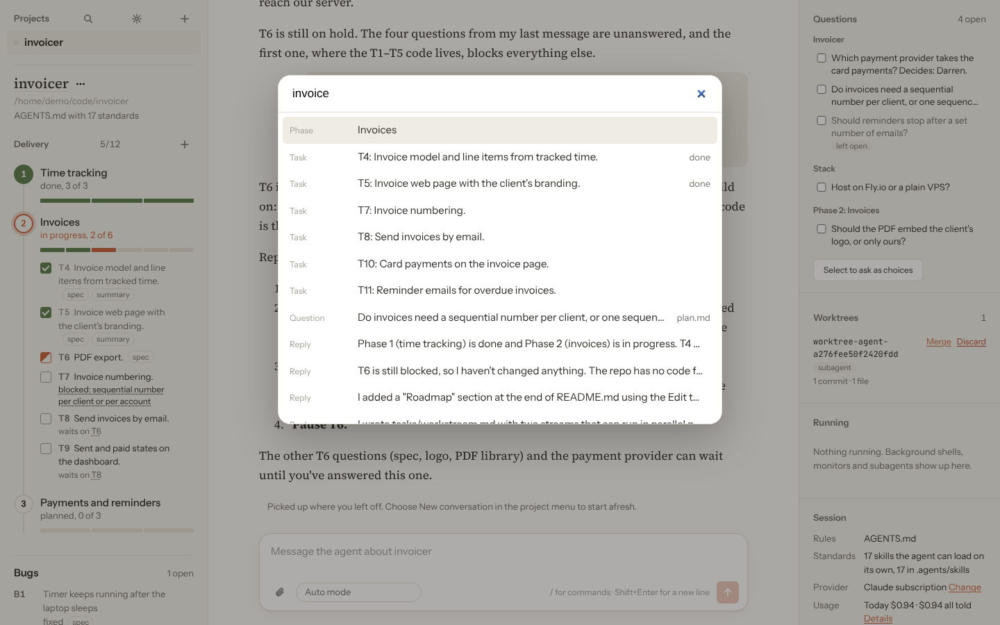

## Git

Under the project's name, a line shows where its git repository stands: the branch, commits to
pull (↓) and to push (↑), and how many files have uncommitted changes. It uses the git you have
installed, with your usual credentials (SSH agent or credential helper). If git isn't installed it
says so, and a folder that isn't a repository offers **Initialise git**.

- **Fetch** happens by itself when the project opens and every 5 minutes (change it in Settings).
  It only downloads; it never changes your files.
- **Pull** with the ↓ button. It only fast-forwards: when your branch has commits of its own too,
  it stops and says so, and you can ask the agent to merge. Pulling while the agent is working asks
  first.
- **Push** with the ↑ button, or **Publish** a branch that isn't on the remote yet. It never forces.
- **Commit** with the "uncommitted" button: the agent reads the changes and commits them in sensible
  pieces with clear messages, leaving out anything that shouldn't be committed. It doesn't push.
- **Pull automatically**, in the branch menu, is off until you turn it on for a project. It then
  pulls after each fetch, but only when it's a fast-forward, the agent is idle and nothing is
  uncommitted.

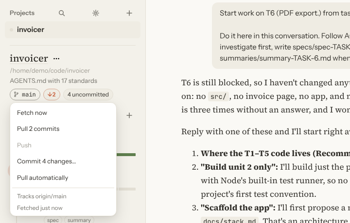

## Questions

The right side lists every open question in one place: the ones the agent asked in its latest
reply, and the **Open questions** recorded in `plan.md`, `docs/` and the phase documents. Click one
to answer it in a box beside the conversation, or tick several and choose **Ask as choices**: the
agent then asks them as multiple choice, with the options it recommends marked.

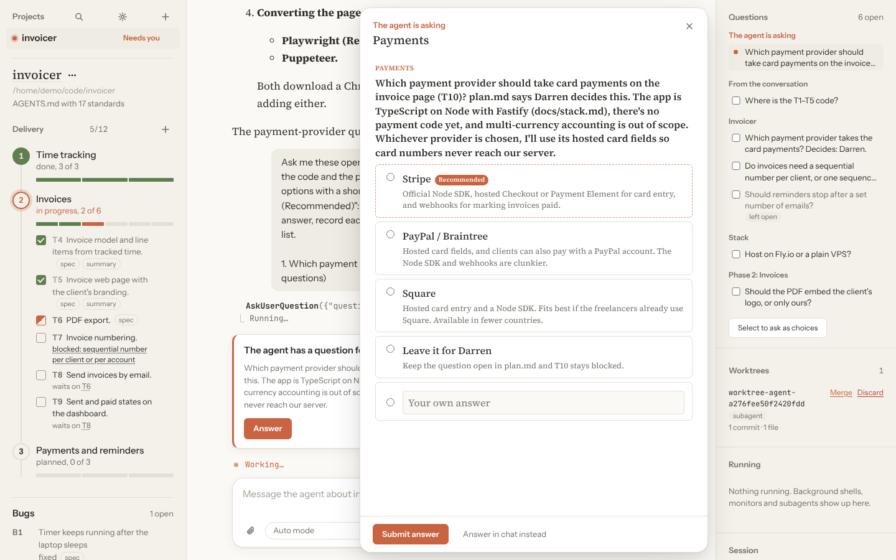

When the agent asks a multiple-choice question itself, it opens straight away. Answer one question
and the next opens. Answers to recorded questions ask the agent to note the decision in the document
and take the question off its list.

## Permissions

The menu in the message box sets how the agent asks before acting, per project:

| Mode | What happens |
|---|---|
| Ask before acting | You approve each action that changes something. |
| Accept file edits | File edits go ahead; other actions ask. |
| Auto mode | Routine actions are approved automatically and risky ones ask. Needs the Claude subscription. |
| Plan only | The agent plans but doesn't change anything. |
| Skip all permission checks | Nothing asks. Use it only where that's safe. |

Each project remembers its mode.

## New projects

**+**, then **New project**, asks for a name, where to put it, whether to start a git repository
(and its remote), and what instructions the agent should follow:

- **Full agent-framework:** every standard from agent-framework, installed with its own installer.
- **Task tracking only:** an `AGENTS.md` with just agent-framework's task and bug tracking rules.
- **Nothing:** an empty folder.

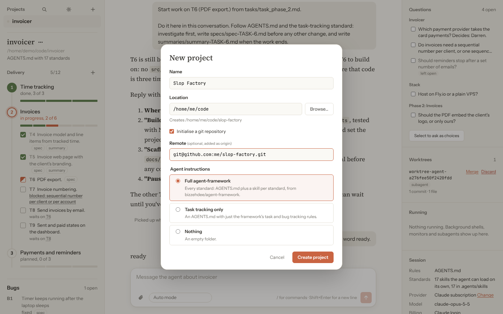

## The project menu

The ⋯ beside the project's name opens its folder in your file manager, opens it in an editor
(Visual Studio Code, Cursor, Zed, Sublime Text, IntelliJ IDEA, WebStorm or PyCharm, whichever are
installed), shows the plan, copies the path or closes the project.

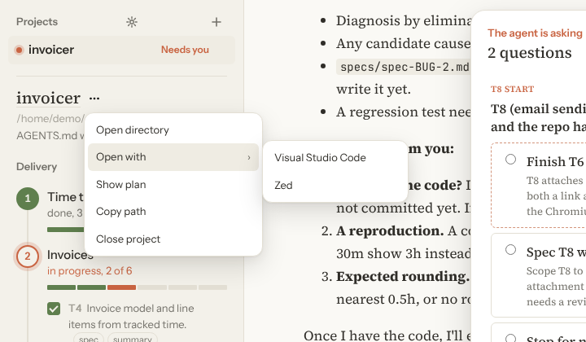

## Usage

The Session panel shows what the project has used today and in all, and **Details** breaks it down:
cost, tokens, turns and time, the last 14 days, and each model. On a local model it counts tokens
only. While you're on your subscription it also shows how much of your current usage limit is
used and when it resets, highlighted as you get close.

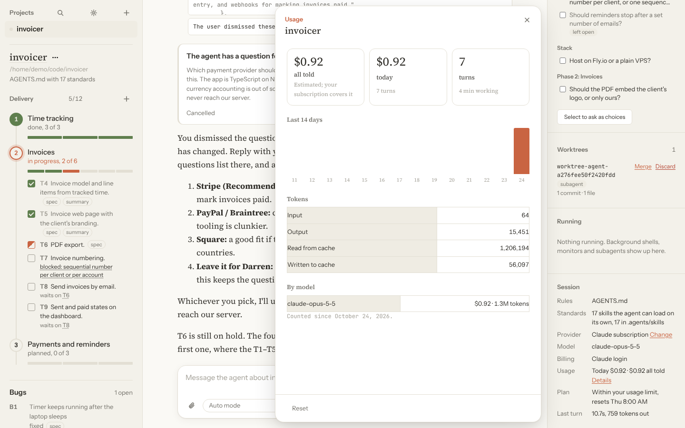

## Settings

The gear beside Projects opens Settings:

- **Appearance:** follow the system, or always light or dark.
- **Notifications:** turn desktop notifications on or off.
- **Git:** how often open projects fetch from their remotes, or never.
- **Model:** the model the current project uses, and your saved local models.
- **MCP servers:** add, change or remove the tools and data sources the agent connects to, for all
  your projects, for one project and everyone who clones it, or for one project just for you.
  Changes apply the next time the agent starts in a project; **Restart it now** applies them at once.

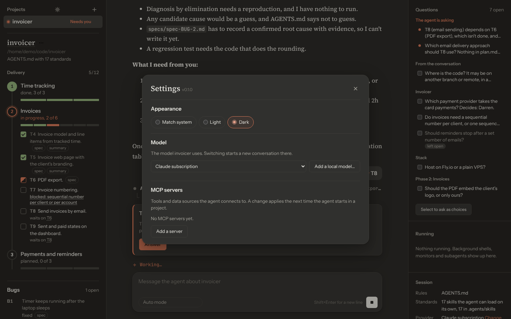

## Local models

Any project can use a model on your own machine instead of your Claude subscription. Open Settings
and choose **Add a local model…**: it fills in the usual address, finds the models the server has
loaded, and switches the project to the one you pick. The agent still does all the work (tools,
edits, subagents, your project's rules); only the model calls go to your server.

| Server | Usual address | Notes |
|---|---|---|
| Ollama | `http://localhost:11434` | Pull a model first, e.g. `ollama pull qwen3-coder`. |
| llama.cpp | `http://127.0.0.1:8080` | Start `llama-server` with a model that supports tool calls. |
| Other | any | Must speak Anthropic's Messages API (`/v1/messages`). |

Pick a model with tool calling and a long context (32k tokens or more); coding models such as
Qwen3 Coder work best. A server that only speaks OpenAI's API needs a translating proxy such as
LiteLLM in front of it. Nothing from a project on a local model is sent to Anthropic.

## Customising a project

A `.slop-factory.json` in a project can change which files the board reads and what each board
action asks the agent to do:

```json
{
  "taskGlobs": ["task.md", "tasks/*.md", "packages/*/tasks/*.md"],
  "prompts": {
    "whereSubagent": "Run it in a background subagent with worktree isolation. Have it push its branch and open a draft pull request for {ref}."
  }
}
```

[Project settings](docs/configuration.md) covers every setting, every prompt with its built-in
text and placeholders, and recipes to start from.

The **Up next** queue is kept in `.slop-factory/priorities.json` in the project. Commit it to share
the queue, or add it to `.gitignore`.

## Keyboard shortcuts

| Keys | Does |
|---|---|
| Ctrl/Cmd+K | Search projects, tasks, questions, documents and messages |
| Ctrl/Cmd+1–9 | Switch to the first nine projects |
| Ctrl/Cmd+O | Open a folder |
| Enter / Shift+Enter | Send / new line |
| `/` | Commands and skills, in the message box |
| Alt+Up / Alt+Down | Move an item in **Up next** |
| Esc | Close the side panel or a menu |

## Good to know

- **Billing.** On your subscription, Slop Factory ignores an `ANTHROPIC_API_KEY` in your
  environment so you aren't billed for API use by accident. The Session panel shows which login is
  in use. Anthropic's terms for using a subscription in other apps have changed over time; check
  the [Agent SDK help article](https://support.claude.com/en/articles/15036540) for the current
  position.
- **Your settings** are kept in `~/.slop-factory`. Settings from earlier versions (`~/.claude-desk`)
  move there by themselves.
- **Usage figures** are estimates, kept in `~/.slop-factory/usage.json`; they aren't a bill.

## Building from source

See [CONTRIBUTING.md](CONTRIBUTING.md).

## Licence

[BSD 3-Clause](LICENSE).
